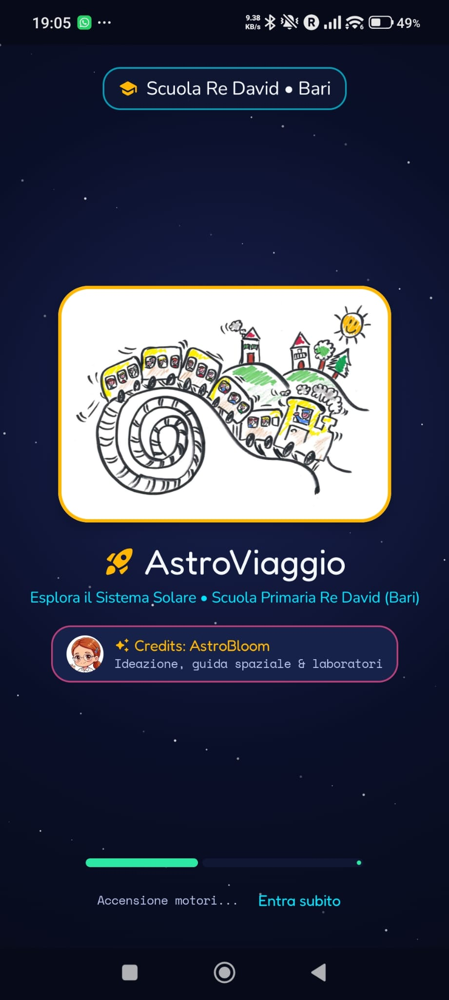
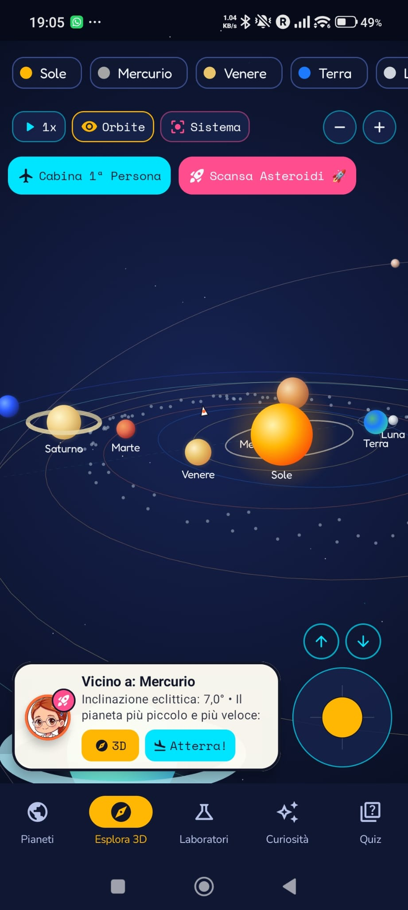
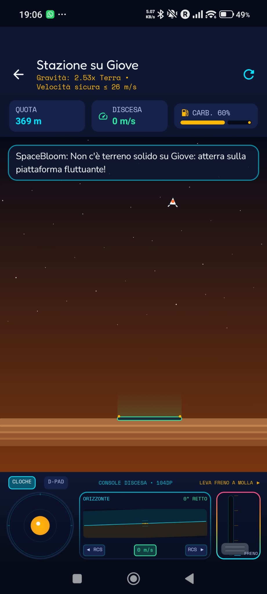
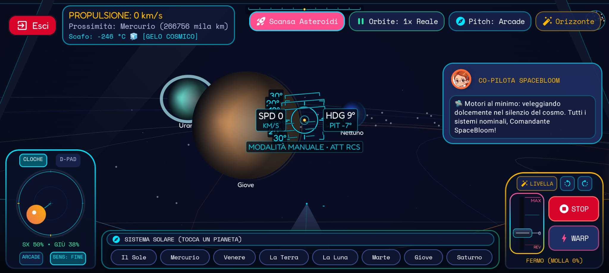
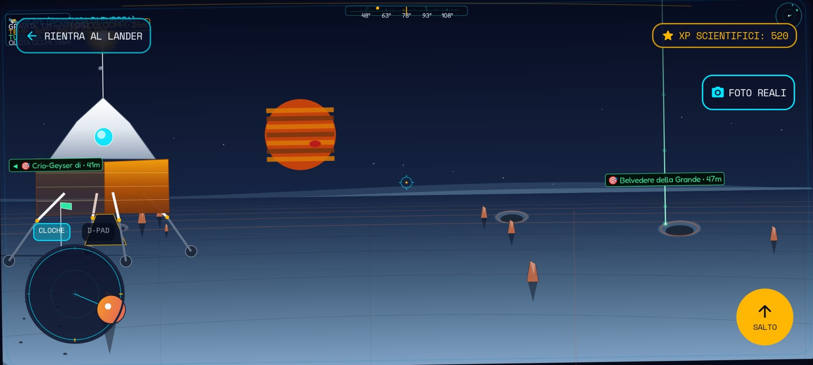
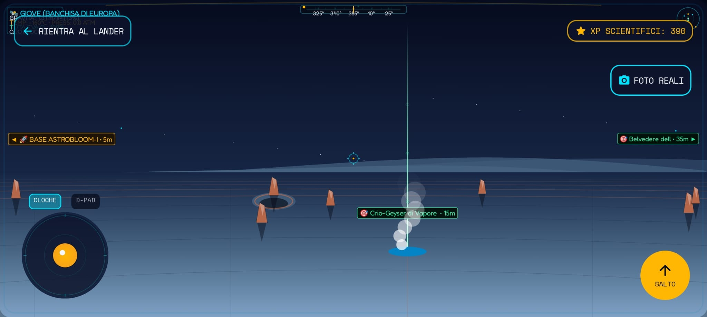
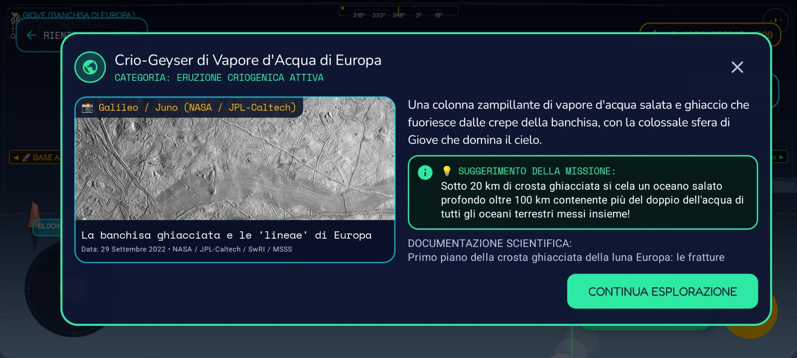
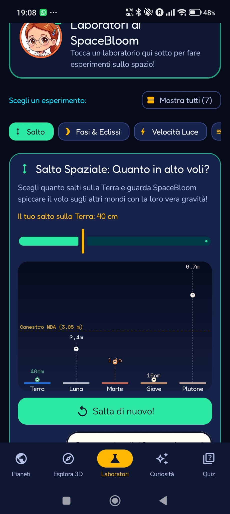
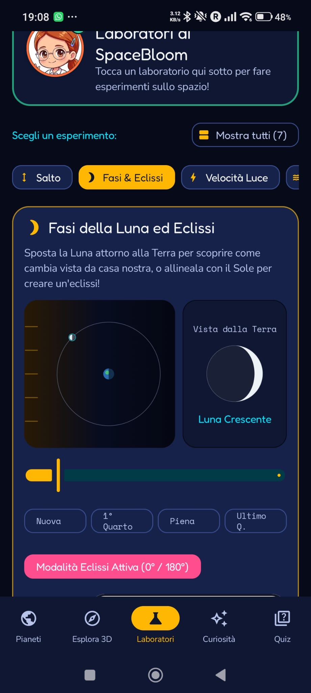
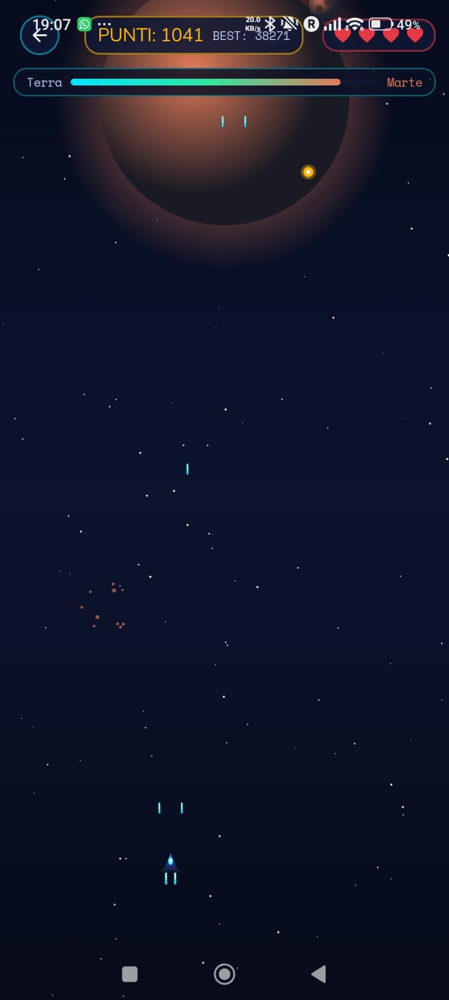

# 🚀 AstroViaggio (AstroBloom)

[](https://www.android.com/)
[](https://kotlinlang.org/)
[](https://developer.android.com/jetpack/compose)
[-informational)](https://developer.android.com/about/dashboards)
[-brightgreen)](https://developer.android.com/tools/releases/platforms)
[]()

> **Dedica speciale / Special Dedication:**  
> 🌟 *Questo progetto è stato realizzato su indicazioni di Emma per un suo progetto scolastico (Scuola Primaria Re David, Bari).*  
> *(This project was created following Emma's creative vision, curiosity, and guidance for her elementary school astronomy project).*

---

## 📖 Overview

**AstroViaggio** is an interactive, educational 3D Android application designed for children and students to explore the Solar System. Combining scientifically accurate planetary mechanics with playful comic-style gamification, the app turns complex astronomical concepts into an engaging, hands-on learning adventure.

The app works **100% offline** and features custom native 3D celestial rendering, real space agency photographic archives (NASA, ESA, Roscosmos, JAXA), interactive physics laboratories, lunar and planetary landing simulations, first-person surface rover exploration, spacecraft flight cockpits, and educational trivia quizzes.

---

## 📸 Screenshots & Visual Tour

### 🚀 App Launcher, 3D Orrery & Space Flight Cockpit
<table align="center">
  <tr>
    <td align="center" width="33%">
      <br/>
      <b>Splash Screen & School Credits</b><br/>
      <i>Scuola Primaria Re David (Bari) & AstroBloom launch screen</i>
    </td>
    <td align="center" width="33%">
      <br/>
      <b>3D Solar System Orrery</b><br/>
      <i>Interactive Keplerian orbits, asteroid belt & planet focus</i>
    </td>
    <td align="center" width="33%">
      <br/>
      <b>Descent & Landing Simulator</b><br/>
      <i>Jupiter cloud floating station landing with thruster physics</i>
    </td>
  </tr>
</table>

<table align="center">
  <tr>
    <td align="center">
      <br/>
      <b>First-Person Flight Simulator Cockpit</b><br/>
      <i>Aviation HUD with pitch ladder, compass heading, orbital velocity (km/s), warp drive & co-pilot dialogue</i>
    </td>
  </tr>
</table>

### 🥾 First-Person Planetary Surface Exploration & NASA Archives
<table align="center">
  <tr>
    <td align="center" width="50%">
      <br/>
      <b>Surface EVA on Europa (Jupiter)</b><br/>
      <i>Lander, Jupiter on horizon, radar compass, surface POIs & low-gravity jump</i>
    </td>
    <td align="center" width="50%">
      <br/>
      <b>Active Cryo-Geyser Discovery</b><br/>
      <i>Approaching water-vapor cryo-plumes on the icy Jovian crust</i>
    </td>
  </tr>
  <tr>
    <td colspan="2" align="center">
      <br/>
      <b>Scientific Point of Interest & NASA Photographic Record</b><br/>
      <i>Official NASA Galileo/Juno documentation, mission scientific tips, and explorer XP rewards</i>
    </td>
  </tr>
</table>

### 🔬 Interactive Science Laboratories & Arcade Mini-Game
<table align="center">
  <tr>
    <td align="center" width="33%">
      <br/>
      <b>Space Jump Lab</b><br/>
      <i>Surface gravity jump comparison across Earth, Moon, Mars, Jupiter & Pluto</i>
    </td>
    <td align="center" width="33%">
      <br/>
      <b>Moon Phases & Eclipses Lab</b><br/>
      <i>Real-time lunar orbit manipulation, Earth perspective & solar/lunar eclipse modes</i>
    </td>
    <td align="center" width="33%">
      <br/>
      <b>Asteroid Dodge Mini-Game</b><br/>
      <i>Arcade asteroid evasion & laser defense between Earth and Mars</i>
    </td>
  </tr>
</table>

---

## ✨ Key Features in Detail

### 🪐 1. Interactive 3D Solar System & Planetary Encyclopedia
* **Planetary Observation**: 3D interactive planet spheres with realistic axial tilt, rotation, and lighting rendered directly on Canvas.
* **Accurate Scientific Data**: Real orbital metrics, diameter, mass ratio, surface gravity, day and year lengths, atmospheric composition, temperature ranges, and notable moons.
* **Age & Weight Calculators**: Calculate your exact body weight (in kg) and age (in local planetary years) across Mercury, Venus, Mars, Jupiter, Saturn, Uranus, Neptune, and Pluto.
* **Comic Story Panels**: Educational dialogues, fun trivia, and character expressions customized for young explorers.

### 🌌 2. Free Space 3D Orrery
* **Keplerian Orbital Mechanics**: Real-time simulation of planetary orbits respecting Keplerian orbital elements (inclination, eccentricity, longitude of ascending node, periapsis, and mean anomaly).
* **Interactive Navigation**: 360° touch gesture rotation, pinch-to-zoom, orbital trajectory paths, realistic vs. accelerated time scales, and instant planet focus.

### 🚀 3. First-Person Flight Cockpit
* **6-DOF Spacecraft Piloting**: Full piloting controls (thrust, pitch, yaw, roll) inside a detailed spacecraft cockpit.
* **Aviation & Space HUD**: Real-time Heads-Up Display featuring pitch ladder, compass heading, orbital velocity (in km/s), target distance tracking, and planetary radar lock.

### 🛬 4. Lunar & Planetary Landing Simulator
* **Descent Physics**: Real gravity-based descent simulation with vector thrust controls, vertical and horizontal velocity dampening, and fuel conservation.
* **Multiple Celestial Targets**: Practice soft landings on the Moon, Mars, and other celestial bodies (Earth excluded as launch base).

### 🥾 5. Planetary Surface Exploration & Field Geology
* **First-Person Surface Traversal**: Walk and explore planetary surfaces with realistic atmospheric scattering, horizon coloration, and gravity physics.
* **Points of Interest (POIs)**: Discover historical landing sites (e.g., Apollo 11 Tranquility Base, Mars Jezero Crater, Gale Crater, Venera landing sites).
* **Rock & Mineral Sampling**: Collect geological samples with realistic chemical/spectrometric formulas, scientific significance, and rarity ratings.
* **Official Space Agency Gallery**: Built-in high-resolution offline photographs from NASA, ESA, Roscosmos, and JAXA missions (Apollo, Curiosity, Perseverance, Ingenuity, Cassini-Huygens, Venera 13, Voyager 2, New Horizons).
* **Explorer XP**: Earn discovery points, level up, and record field achievements.

### 🔬 6. Interactive Science Laboratories
* **Space Jump Lab**: Compare your physical jump height under different surface gravitational pulls.
* **Space Thermometer Lab**: Explore temperature extremes across celestial bodies, from icy dwarf planets to scorching infernos.
* **Cosmic Bathtub Lab**: Learn about planetary density and buoyancy (e.g., discovering whether Saturn would float in a giant bathtub of water).
* **Speed of Light Lab**: Visualize photon travel time from the Sun to each planet.
* **Moon Phases & Eclipses Lab**: Interactive geometry showing how lunar phases, solar eclipses, and lunar eclipses occur.
* **Orbits & Seasons Lab**: Understand axial tilt, solstices, equinoxes, and seasonal shifts.

### 🎮 7. Mini-Games, Quizzes & Customization
* **Asteroid Dodge**: Fast-paced arcade evasion mini-game dodging orbital debris and asteroids.
* **Gamified Quizzes**: Galactic challenges, quick True/False rounds, and topic-specific planet tests with streaks, local leaderboards, and unlockable space badges.
* **Astronaut Customization**: Personalize your space explorer companion (hair styles, skin tones, suit colors, glasses, freckles).
* **100% Privacy & Offline-First**: No ads, no tracking, and no external server requirements. All progress is saved locally on-device.

---

## 🛠️ Architecture & Implementation

The application is engineered strictly with modern Android best practices, leveraging **100% Kotlin** and declarative **Jetpack Compose**:

```
AstroBloom / AstroViaggio
├── docs/
│   └── screenshots/                         # High-resolution screenshots showcasing app features
├── app/src/main/java/com/ricrug/
│   ├── MainActivity.kt                      # Root entry, navigation host & responsive layout
│   ├── model/
│   │   └── SolarModels.kt                   # Celestial models, profiles, comic panels, quiz schemas
│   ├── data/
│   │   ├── SolarSystemData.kt               # Comprehensive planetary and astronomy repository
│   │   ├── SurfaceExplorationData.kt        # Official photo records, surface POIs & rock samples
│   │   ├── OrbitalMechanics.kt              # Keplerian orbital mathematics & vector physics (OrbitVec3)
│   │   └── ExplorerPreferencesRepository.kt # DataStore persistence for scores, XP, badges & settings
│   ├── viewmodel/
│   │   └── AstroViewModel.kt                # Unidirectional Data Flow (UDF) & reactive state management
│   ├── ui/
│   │   ├── components/
│   │   │   ├── Interactive3DPlanetCanvas.kt # Native Canvas 3D sphere raymarching & shaders
│   │   │   ├── FreeSpaceExplorer3D.kt       # 3D Solar System orrery with orbital rendering
│   │   │   ├── FirstPersonFlightSimulator3D.kt # 3D flight cockpit & HUD graphics
│   │   │   ├── SurfaceFirstPersonViewer3D.kt   # 3D surface horizon, terrain & sample rendering
│   │   │   └── ChibiAvatar.kt               # Vector-drawn customizable astronaut companion
│   │   ├── screens/
│   │   │   ├── SplashScreen.kt              # School dedication & animated launcher
│   │   │   ├── PlanetsHomeScreen.kt         # Solar system planetary carousel & overview
│   │   │   ├── PlanetDetailScreen.kt        # Deep dive into individual planet statistics & comics
│   │   │   ├── FreeExploreScreen.kt         # Fullscreen 3D space navigator
│   │   │   ├── FirstPersonSimulatorScreen.kt# Fullscreen spacecraft flight
│   │   │   ├── LandingSimulatorScreen.kt    # Lunar / planetary descent module
│   │   │   ├── SurfaceExplorationScreen.kt  # Surface traversal, sample analysis & photo viewer
│   │   │   ├── AsteroidDodgeScreen.kt       # Arcade mini-game
│   │   │   ├── CuriositiesScreen.kt         # Astronomy trivia, weight & age calculators
│   │   │   ├── QuizScreen.kt                # Gamified trivia quizzes & badge gallery
│   │   │   ├── LabsScreen.kt                # Interactive scientific experiment hub
│   │   │   └── labs/                        # Individual laboratory implementations
│   │   └── theme/                           # Cosmic color palette, typography & shapes
```

### Technical Highlights
* **Native Compose 3D Engine**: Avoids bloated third-party game engines. 3D spheres, lighting gradients, ring projections, and space navigation are rendered directly onto hardware-accelerated Compose `Canvas` using custom vector mathematics (`OrbitVec3`, `SphereVec3`, spherical coordinates, rotation matrices).
* **Responsive Architecture**: Adapts dynamically between mobile portrait screens (bottom `NavigationBar`) and foldable/tablet devices (adaptive `NavigationRail`).
* **State Management**: Reactive MVVM architecture utilizing Kotlin `StateFlow`, `collectAsStateWithLifecycle()`, and structured concurrency with Coroutines.
* **Persistent Storage**: Uses Jetpack **DataStore Preferences** for instant, non-blocking local storage of progress, XP, discovered POIs, and custom character settings.
* **Offline Asset Bundling**: All critical resources, typography (Fredoka, Nunito, Space Mono), and official agency photographs are bundled within Android drawables and WebP assets to ensure instant loading without network latency.

---

## ⚙️ Environment Preparation & Setup

### Prerequisites
* **Java Development Kit (JDK)**: JDK 17 or JDK 21 installed. Verify with:
  ```powershell
  java -version
  ```
* **Android SDK**: API Level 36 (Android 16) and Android SDK Build-Tools.
* **Android Studio**: Ladybug / Meerkat or later (recommended for UI and layout inspection).
* **PowerShell** (Windows) or **Bash** (Linux/macOS).

### 1. Clone the Repository
```bash
git clone https://github.com/your-username/AstroBloom.git
cd AstroBloom
```

### 2. Configure SDK Location
Create a `local.properties` file in the project root (if not already present):
```properties
# Windows example:
sdk.dir=C\:\\Users\\<YourUsername>\\AppData\\Local\\Android\\Sdk

# Linux / macOS example:
sdk.dir=/Users/<YourUsername>/Library/Android/sdk
```

### 3. Configure Secrets & Environment (`.env`)
The project utilizes the **Secrets Gradle Plugin** to manage keys securely:
1. Duplicate `.env.example` to create `.env`:
   ```bash
   cp .env.example .env
   ```
2. (Optional) Provide your Google Gemini API key if enabling server-side AI features:
   ```env
   # AstroViaggio Configuration
   GEMINI_API_KEY=your_gemini_api_key_here
   ```

---

## 💻 Build & Run Commands

The repository includes cross-platform automation scripts (`build-apk.ps1`, `build-apk.bat`, `build-apk.sh`) that handle automated semantic versioning, digital signature verification, and device installation.

### Quick Build (Windows PowerShell)

```powershell
# Compile debug APK and automatically increment build number
.\build-apk.ps1

# Compile and automatically install/update on a connected USB device or emulator
.\build-apk.ps1 -Install

# Clean workspace and rebuild
.\build-apk.ps1 -Clean -Install

# Increment version (bump patch, minor, or major)
.\build-apk.ps1 -Bump minor -Install

# Compile a release APK
.\build-apk.ps1 -BuildType release
```

### Quick Build (Windows Command Prompt / Batch)

```cmd
:: Standard build
build-apk.bat

:: Build and install directly via ADB
build-apk.bat -Install
```

### Quick Build (Linux / macOS Bash)

```bash
chmod +x build-apk.sh gradlew

# Build debug APK
./build-apk.sh --debug

# Build and install on connected device
./build-apk.sh --debug --install

# Clean and bump minor version
./build-apk.sh --clean --bump minor
```

### Standard Gradle Commands

You can also use standard Gradle wrapper commands:

| Task | Command (Windows) | Command (Linux / macOS) |
| :--- | :--- | :--- |
| **Assemble Debug APK** | `.\gradlew.bat assembleDebug` | `./gradlew assembleDebug` |
| **Assemble Release APK** | `.\gradlew.bat assembleRelease` | `./gradlew assembleRelease` |
| **Run Unit Tests** | `.\gradlew.bat test` | `./gradlew test` |
| **Clean Build** | `.\gradlew.bat clean` | `./gradlew clean` |
| **Run Lint** | `.\gradlew.bat lint` | `./gradlew lint` |

### 📦 Output Artifacts
Compiled APKs generated by the automation scripts are saved directly into:
```
dist/AstroViaggio-v<version>-b<build>-<buildType>.apk
```
*(Standard Gradle output is also accessible at `app/build/outputs/apk/`)*.

---

## 🧪 Testing

The project includes both Robolectric local unit tests and physics validation tests:
```powershell
.\gradlew.bat testDebugUnitTest
```

Key test suites:
* `OrbitalMechanicsRealisticTest.kt`: Verifies Keplerian orbit calculations, camera right-hand rule matrices, and HUD calculation consistency.
* `LandingControlsPhysicsTest.kt`: Validates lunar and planetary descent thrust vectors, gravity velocity offsets, and safe landing criteria.
* `SurfaceExplorationTest.kt`: Validates POI discovery tracking, sample collection logic, and XP score aggregations.

---

## 📜 Credits & Acknowledgments

* **Concept & Requirements**: Developed based on the ideas, suggestions, and requirements of **Emma** for her science project at **Scuola Primaria Re David, Bari**.
* **Development**: RicRug.
* **Imagery & Photographic Records**: Official media archives courtesy of **NASA**, **ESA**, **Roscosmos**, and **JAXA**.
* **Fonts**: Fredoka, Nunito, and Space Mono (open-source typefaces via Google Fonts).
